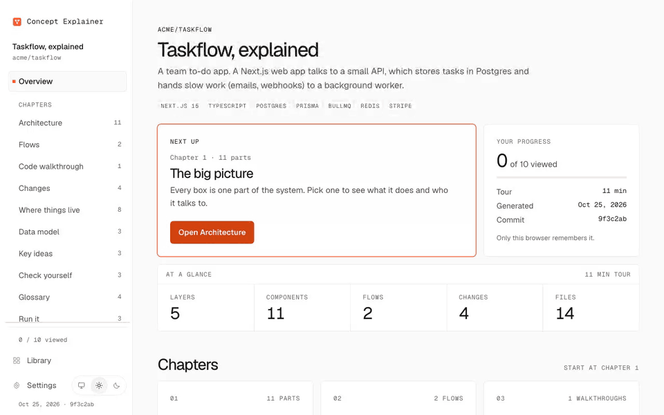
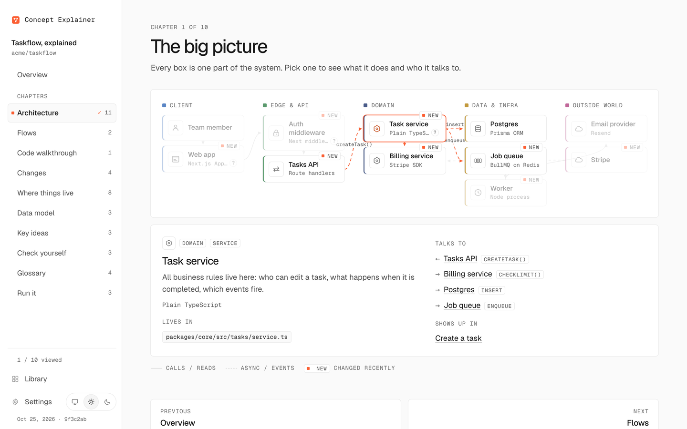
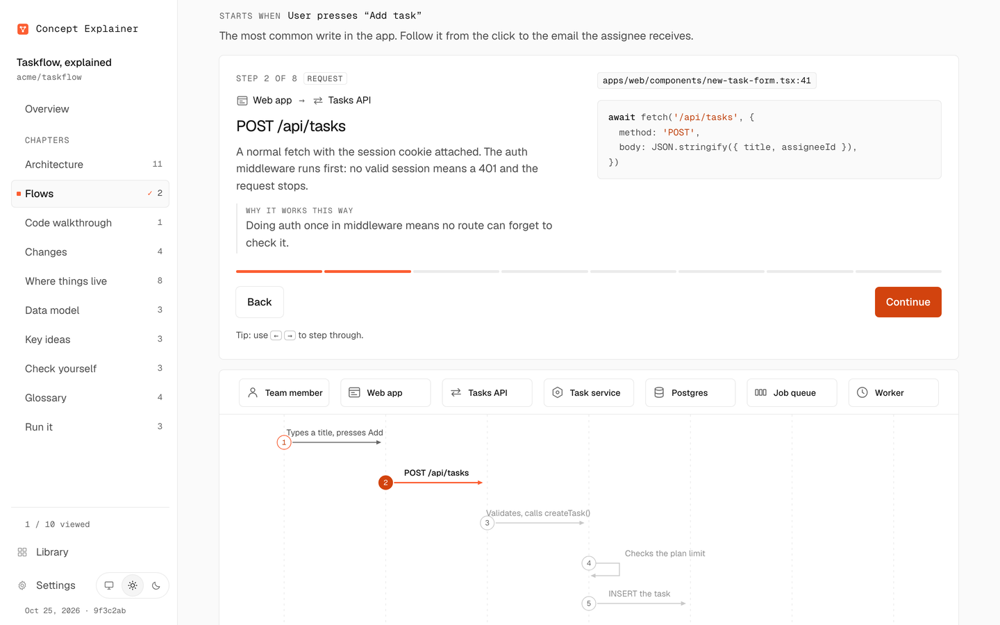
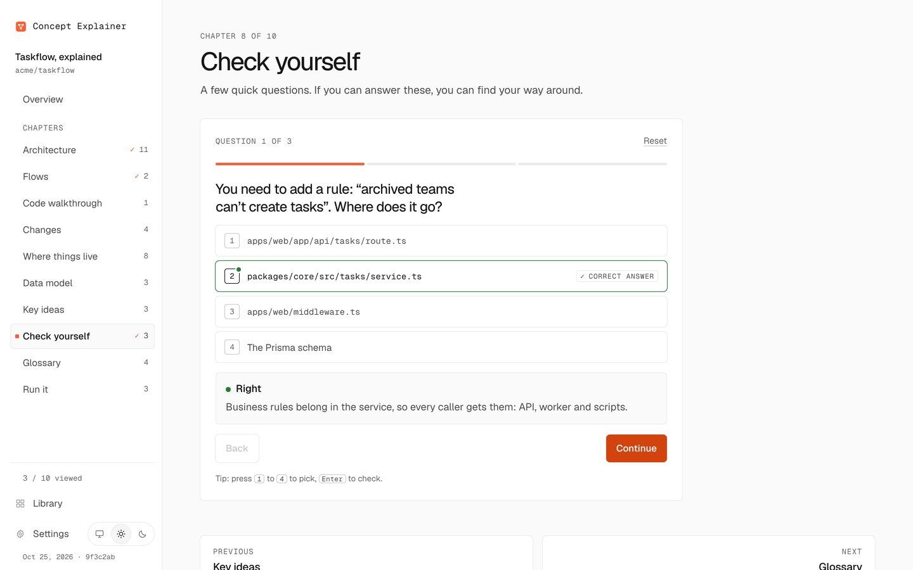

<p align="center">
  
</p>

<p align="center">
  <b>Explain anything technical as a guided, interactive picture.</b><br>
  An agent skill that turns a repo, a PR, a change, a proposal, a migration, an incident or a concept into one page: diagrams first, ideas broken into parts, every claim cited.
</p>

<p align="center">
  <a href="https://github.com/Cyvid7-Darus10/repo-explainer/actions/workflows/ci.yml"></a>
  <a href="LICENSE"></a>
  
  
</p>

<p align="center">
  <a href="https://cyvid7-darus10.github.io/repo-explainer/examples/taskflow.html"><b>Live demo</b></a>
  &nbsp;·&nbsp;
  <a href="https://cyvid7-darus10.github.io/repo-explainer/examples/gallery.html"><b>Kit</b></a>
  &nbsp;·&nbsp;
  <a href="#quick-start"><b>Quick start</b></a>
  &nbsp;·&nbsp;
  <a href="#what-it-can-explain"><b>Types</b></a>
  &nbsp;·&nbsp;
  <a href="#the-library"><b>Library</b></a>
  &nbsp;·&nbsp;
  <a href="#what-a-run-costs"><b>Cost</b></a>
</p>

<p align="center">
  <a href="https://cyvid7-darus10.github.io/repo-explainer/examples/taskflow.html"></a>
</p>

> Concept Explainer was called Repo Explainer. The `repo-explainer` command still works and prints a note; your library moves from `~/.repo-explainer` to `~/.concept-explainer` on the first run, without deleting anything.

## Why

Understanding a repo used to mean reading it. A few people wrote the code, you knew who to ask, and the history told a story.

Picture a busy team today. Twenty merge requests land in a day, many from coding agents. An RFC proposes a new queue. Last night's outage has a ten page post-mortem. Nobody holds the whole picture:

- **What is new**, and **why** was it added?
- **How does it work now**, end to end?
- **What was decided**, against which options?
- **What actually happened**, in what order?

Reading every diff and doc does not scale. Concept Explainer has your agent do the reading, then **teach** the result like a good lesson: one idea at a time, a picture for each idea, and every claim linked to a real line of code or a real source.

## What it can explain

The agent identifies what you gave it, then fills the same format. The library can then filter by type.

| Type | Explains | What you see |
|---|---|---|
| `repo` | A whole codebase | Architecture map, step-through request flows, data model, what changed and why |
| `pr` | One PR or MR | The problem, a file by file diff walkthrough, the parts that move on the map, risks, rollout |
| `change` | One commit or a short range | What moved and why, and what could break |
| `proposal` | An RFC, design doc or idea | Problem and goals, options side by side with the chosen one marked, before and after, rollout |
| `migration` | An upgrade or re-platform | Before and after flows, options, the steps to get there, risks during the move |
| `incident` | A post-mortem | A timeline from the record, how the failure flowed, every contributing cause, follow ups |
| `concept` | An idea like OAuth or CRDTs | The idea broken into 2 to 6 parts, a diagram for each, a worked case, a transfer quiz |

## Show it, don't tell it

Every chapter is a picture first and text second. Options are a comparison grid. Risks are an impact grid. A rollout is a stepped track. A timeline is a time axis. A diff is a file bar chart linked to the map, where moved parts are marked.

For anything else there is a fixed kit of nine visuals, drawn from data only: `layers`, `cycle`, `state`, `compare`, `hierarchy`, `beforeAfter`, `quadrant`, `funnel` and `venn`. Every part is clickable with its own detail, and every view has a link.

Under the pictures is a method for explaining to the root: the agent writes a six line root card (problem, mechanism, invariant, what happens without it, the common misconception, the threshold idea) before it fills anything, picks each visual by the question it answers, and writes quiz questions that test transfer, not recall. See [`references/explaining.md`](references/explaining.md).

## What you get

One self-contained HTML page, laid out as a dashboard. A sidebar lists the chapters and marks where you are. The page opens on an **Overview**: the summary, counts, a card per chapter and where to start. Each chapter is its own view:

- **The big picture.** A map of the parts. Click one to see what it does, its files, and who it talks to.
- **End to end.** Step through each flow on a sequence diagram with a Continue button. Every hop cites `file:line`. Before and after flows sit side by side.
- **What changed, and why.** Recent merges split by human and agent, or one PR file by file.
- **Decisions.** Options against criteria, the chosen one marked, with the reason.
- **Check yourself.** "What happens if" questions with instant feedback that also explains the tempting wrong answer.

| | |
|---|---|
|  |  |
| **Overview.** Summary, counts and where to start. | **Map.** Click a part to see its files, neighbours and flows. |
|  |  |
| **Flows.** One hop at a time, with the code that does it. | **Changes.** Agent or human, the reason, and the risk. |
|  |  |
| **Data.** Relationships first, then fields. | **Quiz.** Instant feedback, with the why. |

**Every view has a link**, so you can send someone straight to a part, a step, a diff file or a diagram: `#map/<node>`, `#flows/<flow>/<step>`, `#diff/<path>`, `#options/<n>`, `#visuals/<diagram>/<part>`. Back and forward work. The full list is in [`references/data-schema.md`](references/data-schema.md#deep-links).

### Styles

Every explainer comes in two styles. Readers switch between them in Settings.

- **Clean** (the default): the dashboard look above, in Geist type and greys with one orange accent.
- **Playful**: brighter colors and rounder, pressable buttons, inspired by [Duolingo](https://www.duolingo.com)'s design language. Concept Explainer is not affiliated with or endorsed by Duolingo, and ships none of its logos, mascots or fonts.

Pick the starting style with `--style clean|playful` on `build`, or set the default with `concept-explainer config set style playful`.

## Estimate before starting

Before any work, the agent shows how long a run will take and what it will cost, and waits for your go-ahead:

```
$ concept-explainer estimate --type pr
Estimate for a pr explainer: assumed 300 changed lines in 10 files (no --base given)

Model       Tokens in  Tokens out  Cost                Time
Fable 5.2   990K       12K         $0.89 to $1.79      8 to 18 min
Opus 5.5    990K       12K         $0.52 to $1.03      6 to 14 min
Sonnet 5.5  990K       12K         $0.26 to $0.52      4 to 10 min
Haiku 5.5   990K       12K         $0.016 to $0.033    2 to 6 min

Recommended: Sonnet 5.5. A good balance of care and cost for a job this size.
```

It sizes the input per type: source files for a repo, changed lines for a PR (`--base`), words for a doc (`--source`). Set `budgetUsd` in config and the agent skips the question whenever the estimate fits. How it works: [`references/estimate.md`](references/estimate.md).

## Quick start

### As an agent skill

```sh
git clone https://github.com/Cyvid7-Darus10/repo-explainer ~/side/concept-explainer
node ~/side/concept-explainer/bin/concept-explainer.mjs install
```

`install` links the skill into `~/.claude/skills/concept-explainer` and writes [`rules/concept-explainer.md`](rules/concept-explainer.md) to `~/.claude/rules/` (both under `$CLAUDE_CONFIG_DIR` when set), so every session builds explainers the same way and files them in the library. It is safe to run again, never replaces a real folder or an edited rule unless you pass `--force` (which keeps a backup), and removes the old `repo-explainer` link and rule only when they are provably its own.

Then ask your agent:

> Explain PR 512 for a reviewer.
>
> Explain how idempotency keys work, with diagrams.
>
> Explain this repo for a new engineer. Trace sign in and checkout end to end.

The agent follows [`SKILL.md`](SKILL.md): it identifies the type, estimates, waits for your go-ahead, finds the root, fills `explainer.json`, builds the page and publishes it to your library. Any agent that can read a skill file and run Node can use it.

### From the command line

```sh
npx github:Cyvid7-Darus10/repo-explainer estimate ./my-repo
npx github:Cyvid7-Darus10/repo-explainer init ./my-repo
npx github:Cyvid7-Darus10/repo-explainer init https://github.com/o/r/pull/7 --type pr --out pr.json
npx github:Cyvid7-Darus10/repo-explainer diff ./my-repo --base main --data pr.json --write
npx github:Cyvid7-Darus10/repo-explainer build pr.json --repo ./my-repo --strict --open
```

Needs Node 18.3 or newer. Nothing to install. The output is one HTML file you can commit, attach to a PR, or host anywhere, plus a copy in your library.

<details>
<summary><b>All commands</b></summary>

| Command | What it does |
|---|---|
| `estimate [input] [--type t]` | Time and cost per model before you start (`--base`, `--source`, `--json`) |
| `scan <repo>` | Stack, entry points, route handlers with `file:line`, data files, env var names (never values), scripts, a suggested preset |
| `init <repo> [--preset id]` | A starter repo explainer with `TODO`s to fill |
| `init [input] --type <type>` | A starter for pr, change, proposal, migration, incident or concept |
| `diff <repo> --base <ref>` | Draft `diff[]` and node statuses from git; summaries stay TODO |
| `changes <repo> [--data f --write]` | Draft change entries from git: human or agent, type, PR link, parts touched |
| `validate <file> [--repo dir] [--strict]` | Check references, shapes, lesson limits, writing style, and that cited files exist |
| `build <file> [--out f] [--repo dir] [--style s]` | Validate, render the page, publish it to the library (`--no-library` skips that) |
| `library [list\|path\|add\|remove\|rebuild\|open\|style\|serve]` | Work with the library |
| `config [get\|set\|reset] [--json]` | The explainer defaults the skill reads first |
| `export [slug...] [--type t] [--tag t] [--out f]` | Share explainers as a data-only bundle |
| `import <file> [--dry-run] [--on-conflict mode]` | Add a bundle to your library |
| `install [--force]` | Link the skill and the library rule into `~/.claude` |
| `presets` | One preset per type, and stack presets for repos |
| `patterns [id]` | Reusable flow shapes: auth, webhook, async job, cache, and more |
| `gallery` | The kit page |
| `assets` | Logo and icon SVGs |

The old `repo-explainer` command is an alias that prints a deprecation note.

</details>

## The library

Explainers pile up across repos, PRs and sessions. So every build also lands in one local folder, `~/.concept-explainer` (or `$CONCEPT_EXPLAINER_HOME`), and its `index.html` puts them all in one place:

- **Search everything.** Parts, flows, single steps, diff files, options, risks, timeline events, diagrams, terms and folders across every explainer. Each result opens the exact view.
- **Browse by type.** Repos, PRs, changes, proposals, migrations, incidents and concepts, each with its status and tags.
- **The kit** sits beside it, one click away.

```sh
concept-explainer build .explainer/explainer.json --repo .   # builds, then publishes
concept-explainer library                                    # list what is in it
concept-explainer library open                               # open the hub
```

The hub is one HTML file that works offline from `file://`. The source of each explainer stays where it was made; the library keeps a copy and the built page. Pass `--no-library` for a throwaway build. Layout, manifest and search index: [`references/library.md`](references/library.md).

### Settings

Each page has a Settings view. **Reading** settings (theme, style, motion, text size, density) stay in your browser. **Explainer defaults** live in `<home>/config.json` and steer the agent: audience, depth, language, preferred visuals, chapters per type, quiz and analogies, model, budget, whether to confirm before starting, and up to 2,000 characters of your own instructions.

```sh
concept-explainer config                       # print them
concept-explainer config set audience newcomer
concept-explainer config set chapters.pr.risks off
concept-explainer library serve                # Settings can save while this runs
```

From `file://`, Settings shows the values and gives you a `config set` command to copy. Through `library serve`, it saves directly. The server binds to 127.0.0.1 only, uses a fresh token per run, checks Host and Origin, and accepts exactly one write: the validated settings.

### Share

Send one explainer, a topic or the whole library to someone else, who imports it into their own library.

```sh
concept-explainer export --type pr --tag payments --out payments.explainers.json
concept-explainer import payments.explainers.json --dry-run    # see what would happen
concept-explainer import payments.explainers.json              # rename on conflict by default
```

A bundle holds explainer data only: no pages, no scripts, no settings, no local paths. The importer checks it as untrusted input (size cap, format, every explainer validated, unsafe links dropped) and rebuilds the pages with its own template. Each page can also export itself, or save itself as one HTML file, from Settings.

## What a run costs

The agent does the costly part: reading and writing the explainer. Estimated cost and agent time **per run** at a typical size, from [Claude API prices](https://claude.com/platform/api) checked November 18, 2026.

| Run | Fable 5.2 | Opus 5.5 | Sonnet 5.5 | Haiku 5.5 |
|---|---|---|---|---|
| Small repo (under 300 source files) | $0.96 to $1.92 | $0.55 to $1.11 | $0.28 to $0.55 | $0.018 to $0.035 |
| Medium repo (300 to 2,000 files) | $2.19 to $4.38 | $1.36 to $2.73 | $0.68 to $1.36 | $0.24 to $0.48 |
| Large repo (over 2,000 files) | $5.70 to $11.40 | $3.75 to $7.50 | $1.88 to $3.75 | $0.69 to $1.39 |
| PR (300 changed lines, 10 files) | $0.89 to $1.79 | $0.52 to $1.03 | $0.26 to $0.52 | $0.016 to $0.033 |
| Concept (3,000 words of sources) | $0.62 to $1.24 | $0.33 to $0.66 | $0.17 to $0.33 | $0.009 to $0.018 |

- **Sonnet 5.5** is a good default. A medium repo takes it about 8 to 19 agent minutes.
- **Opus 5.5** pays off on large or unfamiliar systems.
- **Haiku 5.5** suits small changes and a daily "what changed" refresh.

These are estimates, not quotes. They assume most repeated context comes from the prompt cache. Run `concept-explainer estimate` for your input. On a Claude subscription, usage counts against your plan instead.

## Built to stay consistent

Agents only write data. The design, components, icons, visuals and motion are fixed and tested, so every explainer looks the same and readers learn it once. The look is a Geist dashboard: Geist type and greys, one orange accent for "where you are", hairline rings instead of shadows, one 6px radius, and layer colors as small markers. See [`references/design-system.md`](references/design-system.md).

- **One data contract**, checked on every build. See [`references/data-schema.md`](references/data-schema.md) and [`references/types.md`](references/types.md).
- **Presets per type** and **flow patterns**, so agents start from a proven shape.
- **Explaining rules:** root card first, visuals picked by the question they answer, captions that state the takeaway, analogies that say where they break. Some are enforced as warnings.
- **Writing rules:** gist first, short sentences, no filler.
- **Design guardrail tests** fail CI on blurred shadows, gradients, colors outside the tokens, stray radii, other fonts or `innerHTML`.
- **Truthfulness:** code claims cite real files and `--repo` checks they exist; proposals never show planned parts as built; incident times come from the record; reasons come from PRs, commits and docs, never made up.

## Security and privacy

- The scanner reads env var **names** from example files only. It never opens `.env`.
- All text renders as plain text, and embedded data is escaped. Links must be `http` or `https`.
- Pages make no requests to anyone else. Library pages load self-hosted fonts from the library folder; standalone pages use system fonts. Each page carries a Content Security Policy that allows only its own inline code.
- The library lives only on your machine. Slugs are limited to `[a-z0-9-]`, files are written atomically, and the hub only follows links into its own `explainers/` folder.
- `library serve` binds to 127.0.0.1, needs a per-run token for every API call, checks Host and Origin, and serves only pages and fonts, never your library's data or settings.
- Text from repos, PRs, docs and bundles is treated as data: the skill never follows instructions found in it or runs its commands, and the CLI rejects hidden control characters and never lets git run the repo's own hooks.
- `import` treats a bundle as untrusted: a size cap, prototype keys dropped, every explainer validated, unsafe links dropped, and pages rebuilt locally.
- Git runs with argument arrays, never through a shell, and refs that look like options are refused.

Report vulnerabilities through [SECURITY.md](SECURITY.md).

## Credits

- **Type and greys** come from [Geist](https://vercel.com/geist), the Vercel design system.
- **Lesson pacing** is inspired by [Brilliant](https://brilliant.org): one idea per step, with a Continue button.
- **The Playful style** is inspired by [Duolingo](https://www.duolingo.com)'s design language.
- **Explanation design** draws on Bret Victor's [Explorable Explanations](https://worrydream.com/ExplorableExplanations/), Red Blob Games, the C4 model, and the research collected in [`references/explaining.md`](references/explaining.md).

Concept Explainer is independent and not affiliated with or endorsed by Vercel, Brilliant or Duolingo. It includes none of their logos, mascots or illustrations. Type is [Geist and Geist Mono](https://vercel.com/font), self-hosted under the SIL Open Font License (`fonts/OFL.txt`). The icons and the mark are original.

## Contributing

Issues and pull requests are welcome. Read [CONTRIBUTING.md](CONTRIBUTING.md) and run `npm run check` before opening a PR.

## License

[Apache License 2.0](LICENSE). If you use or adapt this project, keep the [NOTICE](NOTICE) file, which credits Cyrus David Pastelero, as the license requires.
